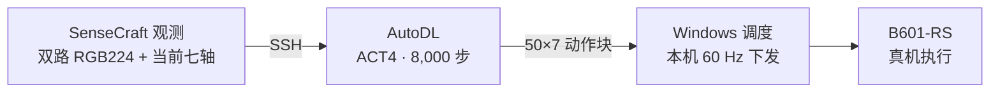

# ACT 真机

[项目首页](../) · [仿真实验](../ACT仿真/) · [成功回放](evaluation/media/act4-trial01-grasp.mp4) · [8,000 步模型包](https://github.com/Artymis11/ACT/releases/tag/act4-8000-20261120) · [发布验证](evaluation/release-validation.json)

11 月 20 日封存的 **ACT4 低学习率 8,000 步版**。ReBot Arm 102-LD 示教，B601-RS 执行，顶部 D435i 与腕部 D405 提供双路画面。60 集示教用于训练与留出验证，封存的第 1 轮双摄确认红块被夹起并入盒。 [会话摘要](evaluation/frozen-session.json)

## 推理链路

J1–J6 以 165°/秒限速插值，并按系数 0.01 做时间集成。夹爪 J7 沿用原执行队列。 [推理契约与操作员流程](inference/)

## 七个模块

| 环节 | 模块 | 内容 |
| --- | --- | --- |
| 采集 | [硬件与标定](hardware/) | 主从臂、双摄、CAN、七轴坐标和验收 |
| 采集 | [遥操作与采集](teleop_collect/) | SenseCraft 录制流程、跟随诊断和样例配置 |
| 训练 | [数据集与预处理](dataset/) | 54 训 6 验、RGB224、动作均值滤波、491 帧双摄样例 |
| 训练 | [ACT 训练与权重](training/) | 环境锁定、训练续训入口、8,000 步选型 |
| 部署 | [云端推理与真机执行](inference/) | 模型清单、SSH、限速调度、按键试次 |
| 验证 | [真机评测与回放](evaluation/) | 成功与漏夹录像、离线误差和传输对照 |
| 验证 | [项目历程与方法论](docs/) | 折返、抖动和时延的分析，实验取舍与记录方法 |

## 复现顺序

1. 下载模型包，核对 11 个文件的 SHA-256，然后在 CPU 上复测一帧真实 RGB224、七轴状态和原始 RPC 动作。 [模型清单](inference/model-manifest.json) · [离线复测](evaluation/#同帧离线复测)
2. 准备云端服务和 Windows 原厂环境，完成 SenseCraft 文件预检，再由现场操作员启动。 [部署与预检](inference/)
3. 复跑训练时按固定划分重建完整训练集，再生成图像缓存和启动训练。 [数据处理](dataset/) · [训练入口](training/)

208 件封存文件已重新核对 SHA-256。公开版的启动入口支持配置 SenseCraft 路径，内含经过核验的源码和现场证据。 [核心源码](autodl/) · [源码清单](inference/snapshot-source.json) · [作者及上游](docs/third-party.md)
