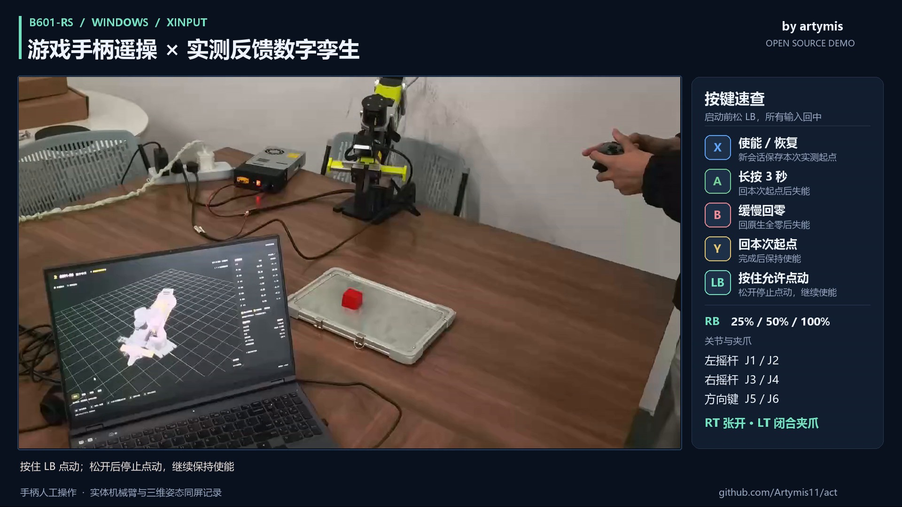
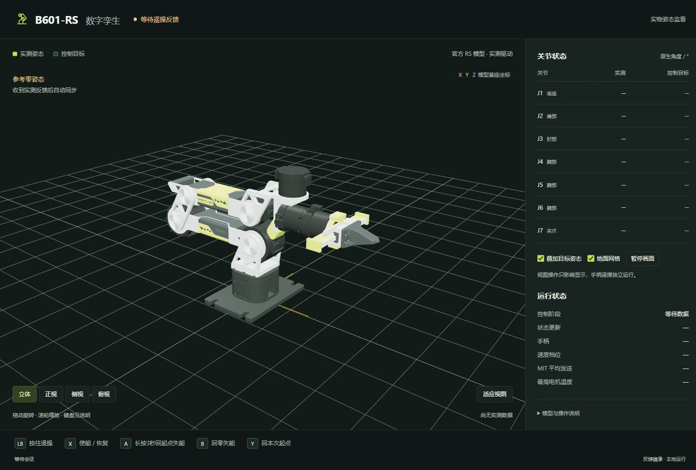
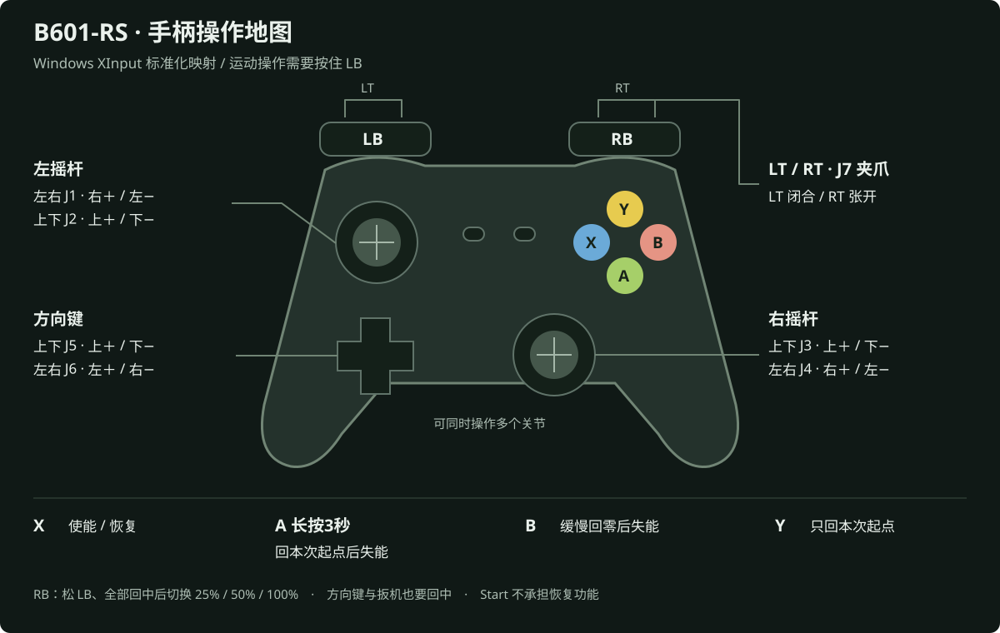

# reBot B601-RS 手柄遥操与 Web 数字孪生

作者：**artymis** · [Artymis11](https://github.com/Artymis11)

用北通斯巴达2无线手柄控制 reBot Arm B601-RS，在 Windows 浏览器中查看由电机实测角度驱动的三维机械臂。

这个项目把手柄输入、七轴原生角控制、会话起点管理、单向软件边界、平滑返回和中文三维监看整理成一套可复现的本地工作流。适合需要人工遥操、观察关节状态和准备示教采集的开发者。

本项目借鉴 [Tony 的手柄遥操设计与源码](https://github.com/TonyWeyyy/reBot_B601_rs_xbox_teleop)。

## 实拍展示

[](../media/B601RS_gamepad_digital_twin_demo.mp4)

[打开／下载带按键说明的展示视频](../media/B601RS_gamepad_digital_twin_demo.mp4)。动作由操作者通过手柄输入，三维模型由电机实测反馈驱动；本片展示遥操与姿态监看，不是 ACT 自主推理或抓取演示。



界面预览：尚无实测反馈时，显示明确标注的参考姿态；这里不是实物实时运动截图。

## 先看这里

| 想做什么 | 打开哪份说明 |
| --- | --- |
| 确认设备型号、接线、驱动和 Python | [设备与环境](docs/01-设备与环境.md) |
| 弄清每个按键及操作顺序 | [手柄按键详解](docs/02-手柄按键详解.md) |
| 理解 J2/J3 为什么是 0°～126° | [单侧零点与 70% 工作范围](docs/03-J2J3与单向软限位.md) |
| 使用三维模型和目标影子 | [Web 数字孪生](docs/04-Web数字孪生.md) |
| 看整个工作的形成过程与新增内容 | [开发全过程与更新设计](docs/05-开发全过程与更新设计.md) |
| 阅读控制链和修改源码 | [架构与源码导读](docs/06-架构与源码导读.md) |
| 手柄在线但机械臂不动、模型不更新 | [常见问题](docs/07-故障排查.md) |
| 复现软件检查和了解实机记录范围 | [测试与验证](docs/08-测试与验证.md) |
| 让其他 AI 帮助上传 GitHub | [发布交接说明](PUBLISHING.md) |

## 这套实现包含什么

- Windows XInput 输入适配，明确支持六轴关节与夹爪的独立输入；可同时操作多个关节。
- 自定义 **X／A长按3秒／B／Y** 四键流程，并把使能、回本次起点、回零、失能分开。
- **J2/J3 原生 0° 为单侧行程起点，软件工作区间设为 0°～126°**。
- 工作跨度系数采用 **70%**：保留参考行程的 70%，预留其余 30%；这不是“留下70%不用”。
- 软件边界只挡该关节继续向外，允许反向、其他关节和返回功能继续工作。
- 约 50Hz 手柄目标更新与 200Hz MIT 发送分离，七轴目标整组提交，使用高精度时钟。
- 25%／50%／100% 三档速度、摇杆死区与立方曲线。
- 每次按 X 启动新会话时读取并固定七轴实测起点；不是永远把起点当作全零。
- 120秒无有效操作请求缓慢回零后失能；正常停机后重新等待 X。
- 浏览器三维监看：实测模型、控制目标影子、七轴角度、手柄状态、速度档位和通信统计。
- 不依赖 ROS 2、pygame、npm 构建或 MotorBridge Gateway 的默认运行方式。
- 相对路径启动脚本、固定资源版本、离线回归及 GitHub Actions。

## 对应的设备

| 部件 | 本项目配置 |
| --- | --- |
| 机械臂 | **Seeed reBot Arm B601-RS**，6轴＋1个电机夹爪 |
| J1、J2、J3 | RobStride **RS06**，CAN ID 1、2、3 |
| J4、J5、J6、J7 | RobStride **RS00**，CAN ID 4、5、6、7 |
| 手柄 | **北通斯巴达2无线版**；Windows 必须识别为 XInput 手柄 |
| USB-CAN | 当前后端要求 **PCANBasic 兼容设备**；固定首个 USB 通道 PCAN_USBBUS1 |
| 电机电源 | 本次设备使用 **48V 主电源**；USB连接不能替代电机主电源 |
| 主机 | Windows x64；推荐 Python 3.12 x64；Chrome／Edge 浏览器 |

具体型号、接口限制及替换设备注意点见[设备与环境](docs/01-设备与环境.md)。

## 快速开始

### 1. 准备软件

安装 Python 3.12 x64 和适配器厂商官方驱动，解压本项目到普通本地目录。

首次双击 **`首次准备与检查.cmd`**，或在仓库根目录执行：

```powershell
py -3.12 tools/bootstrap.py
py -3.12 tools/check.py
```

首次准备会从固定版本下载输入参考源码、三维模型及渲染资源，约67MB。后续启动本地资源即可使用。下载只获取文件并核对哈希，不执行参考项目的安装或控制脚本。

真实遥操需要额外注册本机官方 **x64 PCANBasic.dll**：

```powershell
py -3.12 tools/bootstrap.py --pcan-dll "<你的官方安装目录>\x64\PCANBasic.dll"
```

此步骤把DLL复制到本地忽略目录并记录哈希，不会打开CAN。驱动/DLL不包含在公开源码包中。

### 2. 开始遥操与三维监看

1. 接好 USB-CAN，打开手柄和机械臂主电源。
2. 双击 **`一键遥操与数字孪生.cmd`**。保留控制窗口。
3. **松开 LB，摇杆、方向键和两个扳机全部回中，再新按一次 X。**
4. 控制程序读取本次实测起点并使能。进入 ready 后，**按住 LB** 操作。
5. 网页自动跟随同一仓库内最新真实会话。默认初始速度为25%。

也可分开运行：

- `仅启动手柄遥操.cmd`：控制器入口。
- `仅打开数字孪生.cmd`：只打开监看，**不会启动或使能机械臂**。
- `离线回归检查.cmd`：假电机和临时数据测试，不需要接机械臂。

浏览器地址通常是 `http://127.0.0.1:8767/`，端口占用时会选择8768～8777，以启动窗口显示为准。

### 3. 按键速查



| 控件 | 作用 | 使用条件／结果 |
| --- | --- | --- |
| **LB** | 按住才允许手动点动 | 松开停止点动意图，继续保持使能 |
| 左摇杆左右 | J1／底座 | 右：原生角增加；左：减少 |
| 左摇杆上下 | J2／肩部 | 上：增加；下：减少 |
| 右摇杆上下 | J3／肘部 | 上：增加；下：减少 |
| 右摇杆左右 | J4／腕部 | 右：增加；左：减少 |
| 方向键上下 | J5／腕部 | 上：增加；下：减少 |
| 方向键左右 | J6／腕部 | **左：增加；右：减少** |
| RT／LT | J7／夹爪 | RT张开；LT闭合；两者同时有效则保持 |
| **X** | 使能／恢复 | 松LB、全部回中后新按；新会话重新捕获起点 |
| **A 长按3秒** | 回本次起点后失能 | 短按不失能；长按期间停止点动 |
| **B** | 缓慢回零后失能 | 七轴目标返回0；优先于A返回 |
| **Y** | 只回本次起点 | 完成后保持使能 |
| **RB** | 切换速度档 | 松LB、全部回中后按，25%→50%→100%→25% |
| Start／Back／摇杆按下 | 没有配置控制功能 | 当前恢复键是X，不是Start |
| Esc／Ctrl+C | 运行中按B路径停机 | 等待X时可退出监督程序 |

完整条件、长按规则、组合冲突和动作示例见[手柄按键详解](docs/02-手柄按键详解.md)。

### 4. 正常结束

**A 长按3秒：回本次起点后失能。B：回零后失能。** 二者目的地不同。

等返回流程完成、程序重新显示 `disabled_waiting_for_X` 后，可再次按X开始新会话，或在等待X时退出程序再关闭电源。不要把直接关闭控制窗口当作正常停机。

## J2/J3 与70%工作区间

本次机械臂 J2/J3 的原生0°是单侧行程起点，工作角度从0向正方向增加，因此使用：

```text
参考跨度：180°
工作跨度系数：0.70
允许的手动目标范围：[0°, 180° × 0.70] = [0°, 126°]
```

| 关节 | 当前软件手动目标范围 |
| --- | --- |
| J1 | −112.28°～＋112.28° |
| **J2** | **0°～126°** |
| **J3** | **0°～126°** |
| J4／J5 | −63°～＋63° |
| J6 | −126°～＋126° |
| J7 | 0°～170°，单独的夹爪软件范围 |

达到边界后，只阻止该关节继续向外；反向可用，其他轴可用，A/B/Y返回仍可用。原生实测角稍越软件余量也不会被误当作全臂硬件故障。这里调整的是**软件手动目标工作区间**，没有改写机械零位、驱动固件或电机硬件保护。

## Web数字孪生怎么工作


模型跟随 `positions_native_rad`，不是用手柄目标假装实际动作。控制目标通过半透明影子显示，和实测模型分开。出现故障、数据过期或会话结束时，页面保留最后姿态并明确提示；暂停画面只冻结显示，手柄控制独立运行。

## 项目结构

```text
teleop/          手柄输入、会话、规划、CAN、平滑返回及回归测试
input_core/      输入状态与Windows XInput读取基础
digital_twin/    中文3D监看页面、只读服务和显示换算
tools/           固定资源准备、离线检查、打包工具
docs/            设备、按键、限位、开发过程、架构、排错和验证
LICENSES/        第三方许可文本
run.ps1          相对路径Windows启动器
```

## 验证状态

项目已有真实手柄→目标→实际关节反馈变化，以及多次A/B正常结束记录。软件测试覆盖多轴输入、单向软边界、四键生命周期、输入异常与反馈过期；本发布包还进行了迁移后的独立回归检查，结果见[测试与验证](docs/08-测试与验证.md)。

三维页面已接入真实状态文件并完成模型加载、显示操作及异常冻结检查。**本轮发布整理没有进行新的真机动作测试，也没有把三维页面的软件检查称为完整的实物运动同步或模型零位对齐验收。** 当前版本已知问题与复现边界见[故障排查](docs/07-故障排查.md)。

## 许可与参与

本项目新增代码与文档采用 [MIT](LICENSE)；第三方资源见 [THIRD_PARTY.md](THIRD_PARTY.md)。欢迎以脱敏日志、问题复现步骤、设备信息和软件回归用例帮助改进。
