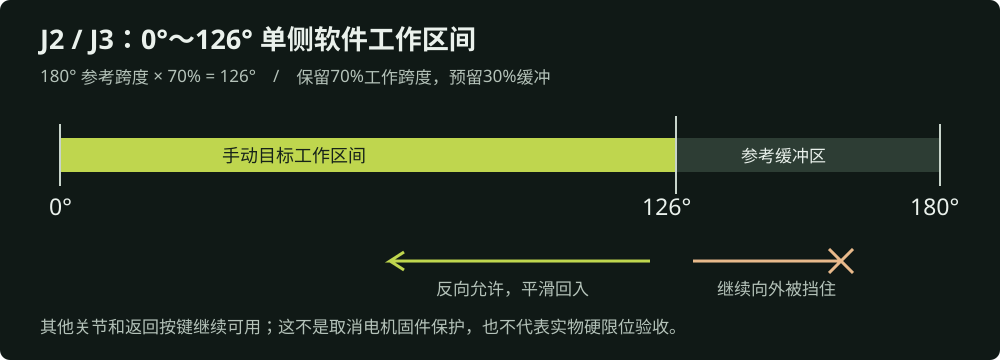

# J2/J3单侧零点、70%工作跨度与单向软边界

## 本次修改解决什么问题

本机J2、J3的原生0°是单侧行程起点，通常从0向正角度方向进入工作区。控制软件应表达这个坐标约定，而不能仅因为某个数学模板围绕0对称，就认为负半轴也可用。

这里说的“打开J2/J3限位”具体是：**把两轴的软件手动目标范围调整为0°～126°，保留70%工作跨度策略**。不是删除所有软件限制，也不是解除电机固件保护。

## 70%怎么计算

J2/J3使用180°参考跨度，取其中70%：

```text
180° × 0.70 = 126°
单侧起点 = 0°
软件区间 = [0°, 126°]
```

一个总跨度126°的对称区间`[-63°, +63°]`，只有0～63°落在本次正向单侧坐标里。把同样的126°工作跨度放到`[0°,126°]`，才符合本机的原生零点解释。这里没有把126°再乘2。

“70%安全余量”在本项目文档中统一解释为**工作范围系数为70%**：保留70%参考行程，预留30%缓冲；不声称已经测得或验收了每台机械臂的硬限位。

## 当前各轴范围

| 轴 | 软件下限 | 软件上限 | 说明 |
| --- | --- | --- | --- |
| J1 | −112.28° | ＋112.28° | 保持原配置，160.4°×0.7 |
| J2 | 0° | 126° | 单侧起点，180°×0.7 |
| J3 | 0° | 126° | 单侧起点，180°×0.7 |
| J4 | −63° | ＋63° | 保持原配置，90°×0.7 |
| J5 | −63° | ＋63° | 同上 |
| J6 | −126° | ＋126° | 保持原配置，180°×0.7 |
| J7 | 0° | 170° | 夹爪单独软件范围，不参与上述统一比例计算 |

配置在`teleop/tony_github_config.py`中生成，运行后写出`teleop/site_config.tony_github.json`。后者是生成文件，不应把单改JSON当作持久修改。

## 到边界后如何操作



单向边界按每个关节分别判断：

- 向正方向运动时，如果实际角或已排定目标达到上限，拒绝继续正向点动。
- 向负方向运动时，如果实际角或已排定目标达到下限，拒绝继续负向点动。
- 反向操作仍允许；其他轴仍允许。
- 既不会因软件余量把全臂故障锁死，也不会因此关闭CAN或失能。
- `soft_limit_blocks`单独记录哪个轴、哪个方向被挡住，不与真实驱动报警混为一类。

### 例子一：J2达到126°

继续推J2正方向 → 保持该轴当前目标；反推 → 允许回到范围内；同时操作J1 → J1照常接受输入。

### 例子二：实测J2略越126°

例如实际回读126.2°。这不自动代表电机过流或硬件越界。手动继续向外会被挡住，反向可以平滑回入；软件不会突然把当前位置跳改成126°。

### 例子三：启动姿态在软件余量外

新会话仍从新读取的实际姿态开始保持，不把初始保持目标强行夹到手动软边界。向外输入保持原目标，向内输入可以逐步回入；不以“修正显示值”的方式掩盖真实位置。

## A/B/Y为什么仍能工作

手动点动边界与受控返回轨迹分开处理：

- A和Y要返回不可变的本次实测起点，即使该起点位于手动软余量外。
- B要沿既定平滑路径回全零。
- 返回不因手动软余量被误判成全臂故障。
- 返回仍受有限数值、协议编码范围、现有运动速度和真实故障条件约束；不是无限制的任意目标发送。

## 软件区间、模型区间、电机保护的区别

| 概念 | 本项目中的角色 |
| --- | --- |
| 软件手动目标区间 | 决定手柄还能否继续向某个方向增加目标 |
| 编码器实测角 | 描述真实回读，不用软件边界篡改它 |
| URDF显示区间 | 模型的描述数据；监看显示允许呈现真实小幅越界 |
| CAN协议编码范围 | 能否编码成合法MIT帧，与机械行程不是同一个范围 |
| 电机固件保护 | 由驱动／电机报告，如欠压、过流或温度报警 |

此次调整不写电机零位、方向寄存器、Flash或固件保护参数。其他关节的软件范围也没有跟着J2/J3扩大。

## 相关测试

`test_directional_soft_limits.py`和`test_soft_limit_semantics.py`覆盖各轴两端向外阻断、反向可用、其他轴继续、已有越界起点不跳变、边界返回和真实故障区分。它们使用假反馈，不是新的实物撞限位试验。
