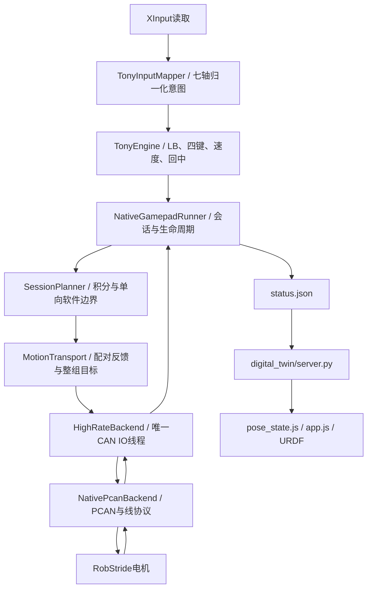

# 架构与源码导读

## 整体分层

## 入口

| 文件 | 用途 |
| --- | --- |
| `run.ps1` | Windows相对路径启动、Python查找、重复进程检测、选择控制／监看／准备／检查 |
| `teleop/tony_teleop.py` | 默认仅描述；显式control与allow-enable才进入等待X的真实控制监督流程 |
| `teleop/enable_latch.py` | 等待新X边沿；原来一直按住X不自动使能 |
| `digital_twin/START_TWIN.ps1` | 后台隐藏启动或复用显示服务，选择可用端口并打开浏览器 |

`teleop/live_runner.py`的直接底层入口保留历史不完整配置回归；普通用户应使用`tony_teleop.py`或根目录启动器，不要把测试用候选配置当作默认生产设置。

## 输入与映射

`input_core/server.py`提供只读Windows XInputReader，`input_core/control_core.py`提供输入状态与回中门控基础。

`teleop/tony_input.py`核对固定参考文件哈希，抽取输入辅助函数，并将Windows标准化轴转成七轴意图。它不直接打开CAN，也不运行外部项目的控制生命周期。

`teleop/gamepad_map.beitong_xinput.json`明确每个控件在标准化空间里的索引。它不是原始HID字节映射，也不是ACT训练坐标映射。

`teleop/tony_engine.py`负责LB、X/A/B/Y、长按计时、RB速度和恢复边沿。它输出完整六轴速度意图及独立夹爪速度。底层基础输入快照中仍可存在`selected_joint`等历史预览字段，但默认实际遥操不靠选中单轴工作；以更新后的七轴意图为准。

## 配置

`teleop/tony_github_config.py`从固定参考常量与YAML生成默认控制配置，并应用本项目J2/J3原生零点解释。

当前PID增益是MIT指令中的KP/KD，不是改写电机Flash中的电流环／位置环参数：

| 轴 | KP | KD |
| --- | --- | --- |
| J1 | 50 | 3 |
| J2／J3 | 150 | 10 |
| J4 | 50 | 5 |
| J5／J6／J7 | 50 | 4 |

默认保留参考速度与返回参数；普通手动MIT速度字段与前馈力矩字段为0，位置变化由软件积分与高频发送实现。

## 会话与控制权

`NativeGamepadRunner`为每次真实控制创建独立SID。捕获起点后不可随意重写；日志、目标和模型状态都不能反过来冒充新的实测起点。

文件命令必须包含本次SID和唯一命令ID，旧会话命令被拒绝。默认手柄流程不需要操作者手工编辑命令文件。

故障保持不是“电机已经失能”。异常退出、外部断电接管、正常回零失能是不同结果，报告保留区别。

## 50Hz与200Hz

主循环约每20ms读取输入并更新七轴目标；高频IO线程约每5ms发送一次七轴MIT组。

`high_rate_backend.py`一次等待一个可关联的真实参数回执，并在等待期间穿插发送。缓存里的各参数保留原始接收时间。`publication_sequence`只表示发布快照，不证明产生了新CAN反馈；`actual_query_sequence`及参数更新次数另行记录。

调度延误跳过错过的发送时刻，不堆积补发；目标积分也不以长延迟补出大位移。Windows使用`perf_counter`时基以避免低精度系统计时引入错误。

## 软边界

`session_core.py`逐轴同时判断实测位置与目标，设置`soft_limit_blocks`。边界只取消继续外推的那一轴的手动速度；反向、其他轴与返回目标仍能处理。

手动软边界不是实际位置的硬故障阈值。已有越界起点保持原目标，不瞬间夹回边界。

## 返回与正常结束

`graceful_stop.py`生成平滑返回轨迹，目的地可为全零或本次起点。现有参数为：最短返回3秒，参考最高返回速度30°/s，目标完成后停留0.3秒。

这里的速度是返回轨迹参考约束，不等同单个实测电机的机械速度验收。发送最终目标、等待停留、确认复位并关闭CAN也不自动证明物理精确到位。

## 线协议与报警

`pcan_readonly.py`定义PCAN结构、允许的参数读与接收解析；`native_pcan_backend.py`加入MIT、使能、正常失能及控制权记录。

默认CAN参数：ID1～7、主机0xFD、1Mbps、PCAN_USBBUS1。MIT位置编码范围与实际机械行程分开，不能把协议能编码的角度当成允许机械运动的范围。

`fault_sources`保存不同通信类型的报警来源。type2/24是六位状态故障，type21是完整32位故障字；解读时保留命名空间、原始ID和data。

## 监看接口

`digital_twin/server.py`仅提供GET状态和限定静态文件，不接受运动POST，不读取任意工作区文件。它不导入控制器、不加载PCAN DLL。

`pose_state.js`保留上一个可显示快照：同一会话一旦非实时，不接受其后续非实时日志反复推动姿态；首次快照、新会话和恢复实时有各自路径。

`app.js`用同一条时间轴插值七轴，更新URDF及表格。显示暂停与物理控制分开；`model_mapping.json`只做显示换算。

## 扩展建议

新增数据记录、相机或界面时，优先复用现有控制所有者的观测与发送记录；不要为了显示再打开一个硬件控制器。更换CAN适配器、手柄协议或物理模型时，应明确新增适配层，不通过更换名称假装兼容。
