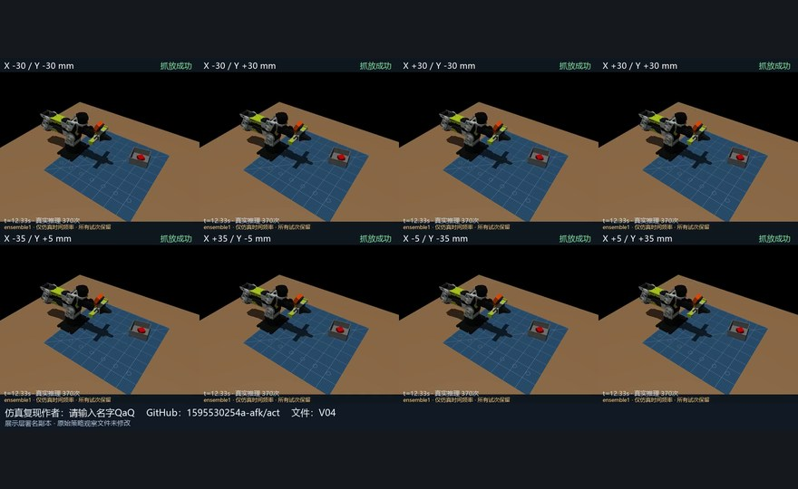
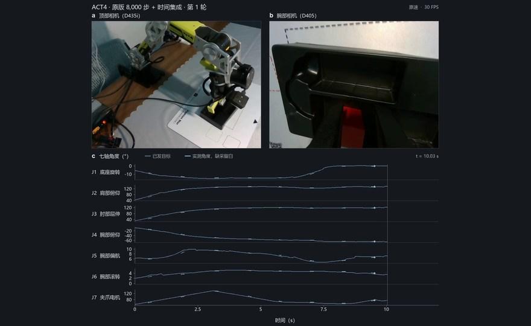

# ACT

红色方块抓放的两阶段复现，从 MuJoCo 多位置仿真到 B601-RS 双摄真机。项目记录了数据、训练、部署和调试过程。

| [MuJoCo 仿真](ACT仿真/) | [B601-RS 真机](ACT真机/) |
| --- | --- |
|  |  |
| **3,000 步 · 预留位置 8/8** 固定场景下的局部 XY 验证。 | **8,000 步 · 11 月 20 日封存** 封存四轮，第 1 轮双摄确认入盒。 |

## 按目标阅读

| 想查什么 | 仿真 | 真机 |
| --- | --- | --- |
| 实验怎样做 | [训练复现](ACT仿真/docs/stage1_20261024/训练复现步骤.md) | [七个模块与推理链路](ACT真机/ACT4-8000-20261120/) |
| 数据和模型在哪 | [训练记录](ACT仿真/results/stage1_20261024/training_record.json) | [双摄示教样例](ACT真机/ACT4-8000-20261120/dataset/example/) · [8,000 步模型](https://github.com/Artymis11/ACT/releases/tag/act4-8000-20261120) |
| 结果如何核对 | [位置验证](ACT仿真/docs/stage1_20261024/runtime_inputs/compact_results.json) | [真机评测与回放](ACT真机/ACT4-8000-20261120/evaluation/) |
| 为什么这样优化 | [训练与调参复盘](ACT仿真/docs/stage1_20261024/ACT仿真训练复现与调参复盘.md) · [PDF](ACT仿真/reports/ACT仿真训练复现与调参复盘.pdf) | [优化历程与方法](ACT真机/ACT4-8000-20261120/docs/) |

作者 **请输入名字QaQ**。 [作者与上游来源](AUTHORS.md)
