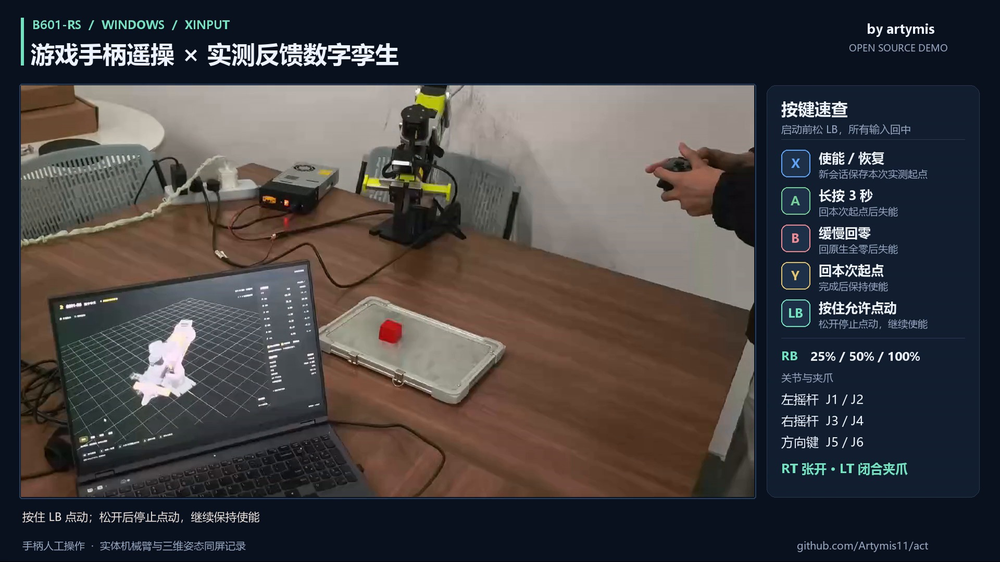

# ACT 仿真与真机分阶段复现

作者：**artymis** · [Artymis11](https://github.com/Artymis11)

本仓库按成果阶段组织：第一阶段记录 ACT 仿真复现，第二阶段逐项发布真机工作的源码与实拍记录。

| 阶段 | 入口 | 当前内容 |
| --- | --- | --- |
| 第一阶段 | [ACT仿真](ACT仿真/) | 仿真源码、训练教学复盘、调参记录、验证结果、署名视频 |
| 第二阶段 | [ACT真机](ACT真机/) | B601-RS 游戏手柄遥操、实测反馈 Web 数字孪生、操作文档与实拍视频 |

最新成果：[B601-RS 手柄遥操与数字孪生](ACT真机/手柄遥操与数字孪生/rebot-b601rs-teleop-twin/)。用 XInput 手柄操纵实体机械臂，并在浏览器中查看实际关节反馈驱动的三维姿态；按键、软件工作范围、上游来源和离线复现方法均随源码提供。

[观看 44 秒静音标注视频](ACT真机/手柄遥操与数字孪生/media/B601RS_gamepad_digital_twin_demo.mp4)。本段演示的动作来自人工手柄输入，ACT 模型采集、训练与真机推理另行记录。

先读[PDF教学复盘](ACT仿真/reports/ACT仿真训练复现与调参复盘.pdf)或[在线文字版](ACT仿真/docs/stage1_20261024/ACT仿真训练复现与调参复盘.md)，再按[复现步骤](ACT仿真/docs/stage1_20261024/训练复现步骤.md)准备数据并训练。

当前仿真选定step3000＋ensemble1：四验证位置4/4，事先保留八点8/8，随后追加一点1/1。结果限于固定场景的局部位置变化。

[作者与上游来源](AUTHORS.md)。本次整理替换当前版本入口，没有改写Git历史；旧提交中的早期部署原型不属于本版发布内容。
